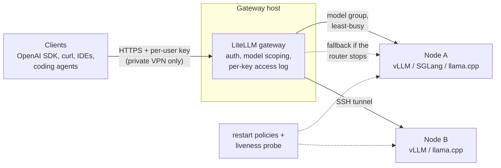

# Self-hosted LLM platform

**Private, OpenAI-compatible LLM inference on owned hardware: AMD Strix Halo and NVIDIA DGX Spark
nodes behind one gateway with per-user API keys.**

> [!NOTE]
> **This is a portfolio version of a project I built and operated in 2026.** Internal configuration,
> hostnames, addresses, keys, usage data and organisation-specific notes have been removed or
> replaced with placeholders such as `<gateway-host>` and `<YOUR_API_KEY>`. The tools, runbooks and
> aggregate measurements are real; the demo runs anywhere without the original servers.

## The problem

A team wanted to use large language models on internal material without sending it to a cloud API,
and to give several people and their tools (IDEs, coding agents, scripts) access through the same
interface they already use for hosted models. That meant answering four questions on real hardware:

1. **Which engine and model** serve fast enough on unified-memory machines that are cheap per GB of
   model capacity but slow per token?
2. **How many users** does one machine serve before quality of service collapses, and does a second
   machine actually double that?
3. **How do people get in** - one endpoint, individual keys, usage you can attribute, no SSH accounts?
4. **How does it stay up** without someone watching it?

## Architecture



- **Engines** run on each node and listen on localhost only. Which engine depends on the model and
  hardware; the [runbooks](docs/runbooks/) give the exact build and flags for each.
- **The gateway** ([LiteLLM](https://github.com/BerriAI/litellm)) is the only thing clients see. It
  checks a static per-user key, limits which models that key may call, logs which key made each
  call, and spreads requests over the nodes that serve the same model. Remote nodes are reached
  through SSH tunnels, so no engine is exposed to the network. On the DGX Spark pair, requests go
  through NVIDIA's Personal AI Router (PAIR) with a direct route to one node as fallback.
- **Reliability:** the DGX Spark engines come back after a crash or reboot through Docker restart
  policies or their installers' system services. For everything else there is a no-root pattern of systemd user services: `Restart=always`
  for crashes, plus a timer that sends a real completion and restarts an engine that is up but not
  answering. That pattern passed three deliberate break-tests on one node; it has not yet been rolled
  out to the multi-node gateway ([details](docs/runbooks/gateway/durable-gateway-user-service.md)).

## What was measured

All figures are aggregates; no prompts or outputs are included. Every number is a range with its
workload named, because throughput moved about ±10% day to day on identical configuration.

### Scaling: two nodes serve twice the users at the same quality

vLLM data-parallel replicas on two Strix Halo nodes, with the load tester splitting users evenly
across both. Qwen2.5-7B-Instruct FP16, 256-token replies, every prompt unique so no cache flatters
the result. Re-run at 32 users through the round-robin proxy in [`tools/lbproxy.py`](tools/lbproxy.py),
as clients would use it: 460.2 tok/s, 64/64 requests, median TTFT 0.46 s, so the proxy adds no
measurable overhead. Full data: [`results/concurrency-ramp.csv`](results/concurrency-ramp.csv).

| Concurrent users | 1 node: aggregate tok/s | 2 nodes: aggregate tok/s | 2 nodes: median TTFT | Failures |
|---:|---:|---:|---:|---:|
| 8 | 119.3 | 127.9 | 0.20 s | 0 |
| 16 | 226.8 | 238.8 | 0.38 s | 0 |
| 32 | 424.1 | 455.2 | 0.68 s | 0 |
| 64 | - | **849.1** | 1.28 s | 0 |

At matched load per node, two nodes deliver **2.00×** the throughput of one (8 users on one node
119.3 → 16 on two 238.8; 32 → 64: 424.1 → 849.1), with each user still at ~14 tok/s, above reading
speed.

### A configuration finding worth more than any optimisation

A concurrency cap (`--max-num-seqs 16`) carried over from an early single-user setup was throttling a
production node. Raising it to 64, at 32 concurrent users on Gemma-4 26B: **+37% throughput (~122 → ~168
tok/s) and median time to first token from ~17.5 s to ~1.4 s.** The same signature showed up
earlier: vLLM reached through a wrapper queued requests at 16 users (median TTFT 11.6 s in the CSV),
consistent with a low concurrency default in the wrapper; launched directly with its own settings
it reached 226.8 tok/s at 0.74 s. Details:
[Gemma-4 runbook](docs/runbooks/strix-halo/gemma4-26b-vllm-serving.md).

### Evaluating options against a bar set in advance

| Option | Result | Decision |
|---|---|---|
| Speculative decoding (DFlash2) on Qwen3.8-27B, llama.cpp Vulkan | ~2.3× decode on real agent traffic, ~1.74× wall-clock on a real task; lossless in distribution, because the full model verifies every token | Recommended recipe for single-user agent work ([recipe](docs/runbooks/strix-halo/qwen38-27b-llamacpp-vulkan-dflash2.md), [how it works](docs/reference/speculative-decoding.md)) |
| SGLang instead of vLLM on Strix Halo | 9.9% faster wall-clock, short of a 15% bar fixed before measuring | Not adopted ([why](docs/reference/tested-and-rejected.md)) |
| A third-party int4 build with built-in multi-token prediction | Slower than the speculative-decoding recipe on every controlled workload measured | Not adopted ([recipe kept](docs/runbooks/strix-halo/rocmfpx-rocmi4-mtp-qwen38.md)) |

More results, including the DGX Spark stacks and long-context behaviour up to ~250k tokens, are in
[docs/reference/numbers.md](docs/reference/numbers.md), with
[how to read these numbers](docs/reference/how-to-read-these-numbers.md) for the method and its limits.
The agent-workload figures came from replaying a recorded coding session, which is not included
here; the concurrency figures came from `tools/loadtest.py`, which is.

## Run it

Python 3.9+ and nothing else: the tools use only the standard library.

```bash
python demo.py                                   # fake engines -> round-robin proxy -> load tester
python -m unittest discover -s tests -v          # self-tests for every tool, plus the demo
```

`demo.py` starts two fake engines that, like real ones, can only work on a fixed number of requests at
once. It runs the same load against one engine and then two behind the proxy:

```text
engines     requests    aggregate tok/s    median TTFT s   max TTFT s
1             32/32               164.6             1.61         3.07
2             32/32               328.7             0.64         1.13

Second engine: 2.00x throughput, median time-to-first-token 1.61s -> 0.64s.
```

Against a real OpenAI-compatible server on localhost:

```bash
python tools/loadtest.py --selftest                               # check the harness first
python tools/loadtest.py --port 8000 --model <model-name> --label my-test --users 8
python tools/lbproxy.py --listen-port 8080 --backends 8000,8001   # one address for two engines
```

## What is in this repo

| Path | Contents |
|---|---|
| [`tools/loadtest.py`](tools/loadtest.py) | Concurrency benchmark: N users released together, streaming time-to-first-token, per-user and aggregate tokens/s, optional shared-prefix mode for agent-style traffic |
| [`tools/lbproxy.py`](tools/lbproxy.py) | Round-robin streaming proxy that relays tokens unbuffered, so latency measured through it stays honest |
| [`tools/model_router.py`](tools/model_router.py) | Routes by model name across engines and normalises vLLM's stream for strict clients (an empty `tool_calls` array made GitHub Copilot drop replies) |
| [`examples/`](examples/) | Placeholder gateway config, per-user key auth hook and systemd units |
| [`docs/runbooks/`](docs/runbooks/) | Step-by-step setup per hardware class: [DGX Spark](docs/runbooks/dgx-spark/README.md), [Strix Halo](docs/runbooks/strix-halo/README.md), [gateway](docs/runbooks/gateway/README.md) |
| [`docs/reference/`](docs/reference/) | Measured numbers, model choice per job, hardware economics, what was tested and rejected |
| [`docs/connecting-clients.md`](docs/connecting-clients.md) | Connecting the OpenAI SDK, curl, Claude Code, Cursor, VS Code, OpenCode and Open WebUI, with the quirks of each |

## What's next

- **Measure deeper contexts under concurrency.** Most multi-user figures are at a few thousand tokens
  of context; agent work on large codebases runs much deeper, where the KV cache, not compute, limits
  how many users fit.
- **Catch degradation, not just failure.** The fallback route protects against the router stopping,
  not against a node that keeps answering slowly. That needs latency alerting (Prometheus and Grafana
  were trialled end to end on one node but not rolled out).
- **Roll out the durable-service pattern** to the gateway, its tunnels and the router, so the whole
  front door survives a reboot the way the DGX Spark engines already do.

## Repository conventions

- No machine identities: nodes are described by hardware class and role, home directories as `~`.
- No secrets: keys are generated on the server, kept in a permission-restricted file and read from
  environment variables.
- Runbooks open with a header stating the hardware, build and date they were verified on; outside
  that scope the numbers are not promises.
- ★ marks something a skimmer must not miss; ⚠ marks a caveat on a claim.
